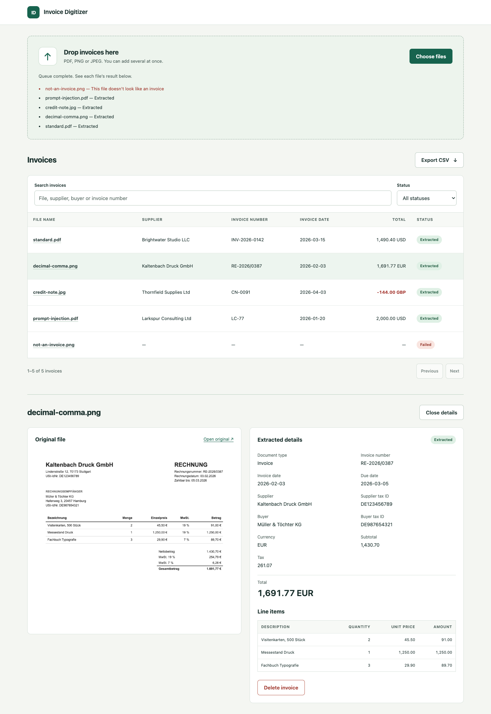

# Invoice Digitizer

Upload an invoice and get structured data back. You drop in a PDF, PNG or JPEG, Claude reads it, and the fields become a record you can search and export to CSV.

It was built for the SoftUni AI-Assisted Development exam with Claude Code and Codex. See [how each tool was used](docs/AI_SETUP.md) and [the prompts behind each module](docs/PROMPTS.md).

Each tool checked the other's work. Codex [reviewed the code Claude Code wrote](docs/PROMPTS.md#prompt-32-review-by-a-second-tool-codex), and Claude Code [tested the page Codex built in a real browser](docs/PROMPTS.md#prompt-42-check-the-page-in-a-real-browser-and-fix-what-codex-couldnt-see-claude-code). Both found bugs that had got past a passing test run.



## What it reads

| Group | Fields |
| --- | --- |
| Document | Type (invoice or credit note), number, invoice date, due date |
| Parties | Supplier and buyer, each with a name and a tax ID |
| Amounts | Currency, subtotal, tax, total |
| Line items | Description, quantity, unit price, amount |

A value that isn't printed on the document stays empty. It is never guessed or shown as 0. Amounts keep their exact decimals, and formats such as `1.234,56` and `1,234.56` both work.

## How it works

1. **Upload.** The file type comes from the file's first bytes, not its name. The file is saved under a generated name.
2. **Read.** The app runs the `claude` command on a copy of the file, with the rules in [`extraction_rules.md`](src/invoice_digitizer/extraction_rules.md) and a JSON schema for the answer.
3. **Store.** The answer is validated and saved to SQLite, and the page updates by itself.

Invoice files are treated as untrusted. The `claude` run can only use its `Read` tool, inside a temporary folder that holds that one file, with no commands, web access or user settings. One of the samples has hidden text telling the AI to change the values, and a test checks that it doesn't.

## Run

You need [uv](https://docs.astral.sh/uv/), and [Claude Code](https://code.claude.com/) logged in with a subscription. No API key is needed.

```bash
uv sync
uv run uvicorn --factory invoice_digitizer.api:create_app
```

Open <http://127.0.0.1:8000>. The API documentation is at <http://127.0.0.1:8000/docs>. Settings are listed in [`.env.example`](.env.example).

## Test

```bash
uv run pytest           # everything except the real model
uv run pytest -m live   # the real model on the sample invoices
```

Normal tests replace Claude with a fake. The browser tests in `tests/test_e2e.py` drive Google Chrome and are skipped if it can't start. The live tests compare every field of the fictional invoices in [`samples/`](samples/) with [their correct values](samples/expected.json), and they use your Claude subscription.

## Limits

This is a proof of concept:

- **No login.** Run it only on your own machine.
- **No review step.** AI-read data is trusted and stored as it is.
- **One server process.** Don't use `--workers`, because each new process marks running extractions as failed.
- **No migrations.** After a change to the database schema, delete the `data/` folder.

Five samples are enough to check the rules but say little about accuracy on real invoices.
